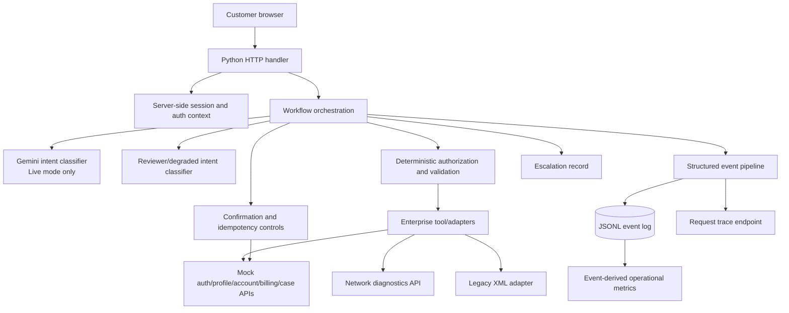

# Solution architecture

## Trust boundaries

- The browser receives an opaque application `sessionId`, never the synthetic access token returned by the mock identity service.
- Gemini receives a bounded request message and a small, sanitized conversation context. It does not receive credentials or execute tools directly.
- Intent outputs are parsed and allow-listed. Record ownership, authorization, action parameters, confirmation, and idempotency are controlled by deterministic Python logic.
- Enterprise reads go through adapters that validate expected response fields. The legacy service response is parsed from XML and normalized before use.
- Consequential case creation happens only after a user confirmation and includes an idempotency key. An unverified backend outcome is never reported as success.
- Telemetry uses trace IDs, sanitized metadata, and stable hashed session references. The actual bearer-like application session ID is never written into new events or returned in traces. Historical local event files are redacted on trace reads as well.
- Metrics, traces, and escalation-list endpoints require an active session with the synthetic `support-agent` role. Customer sessions cannot inspect cross-customer operational evidence.
- Gemini receives a sanitized request summary and sanitized recent user messages only; assistant response history and the server-side enterprise access token are not sent to the model. Support-case summaries and escalation reasons are also sanitized before persistence.

## State/persistence

This challenge PoC keeps session state, pending confirmations, and action deduplication in process memory. It writes structured event and escalation records to JSONL files. This is sufficient for reproducible local reviewer-mode validation, not multi-instance production operation. A production deployment should replace these with durable session storage, a shared idempotency store, a durable event/trace backend, retention policies, and managed identity/secrets.
